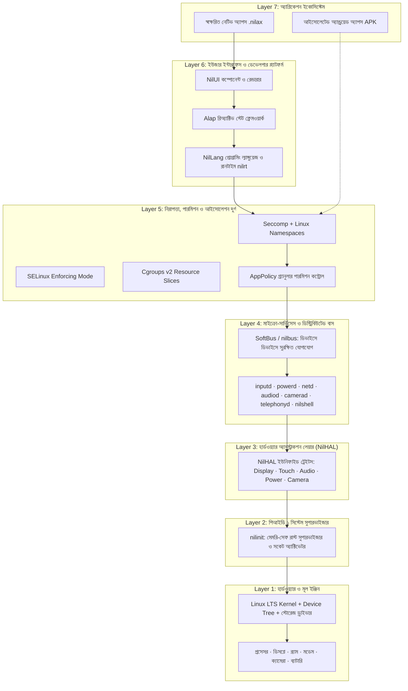
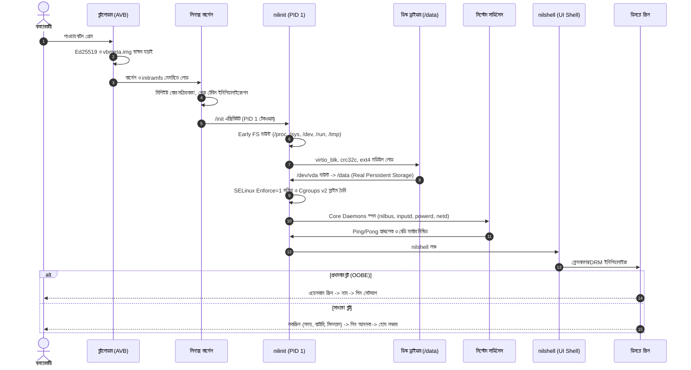

# অনুরণ ওএস (OnuronOS): বর্তমান আর্কিটেকচার, বুট-টু-ইউআই লাইফসাইকেল ও অ্যান্ড্রয়েড ব্রিজের পূর্ণাঙ্গ রিপোর্ট

> **প্রস্তুতকারক ও ব্যবহারকারীদের জন্য একটি বিস্তারিত প্রযুক্তিগত ও ব্যবহারিক রূপরেখা**  
> *নথি সংস্করণ: ৩.০ (অক্টোবর ২০২৬)*

---

## ভূমিকা

অনুরণ ওএস (OnuronOS) কোনো সাধারণ মোবাইল অপারেটিং সিস্টেম নয়। এটি এমনভাবে ডিজাইন করা হয়েছে যাতে এটি একদিকে বিশ্বের শীর্ষস্থানীয় সিকিউরিটি স্ট্যান্ডার্ড (Memory Safety through Rust, SELinux, Cgroups v2) মেনে চলে, অন্যদিকে সাধারণ মানুষের হাতে একটি বিদ্যুৎগতির, দীর্ঘস্থায়ী এবং প্রাইভেসি-সুরক্ষিত মোবাইল অভিজ্ঞতা তুলে দেয়।

এই রিপোর্টে তিনটি প্রধান বিষয় অত্যন্ত সহজ, বাস্তবমুখী এবং বিশদভাবে ব্যাখ্যা করা হয়েছে:
1. **বর্তমান অভ্যন্তরীণ আর্কিটেকচার (Current System Architecture)**
2. **পাওয়ার বাটন চাপার মুহূর্ত থেকে সম্পূর্ণ ইউআই ভেসে ওঠা পর্যন্ত সেকেন্ড-বাই-সেকেন্ড বুট লাইফসাইকেল**
3. **অ্যান্ড্রয়েড ব্রিজ ও কম্প্যাটিবিলিটি সাবসিস্টেমের খুঁটিনাটি (S25 হোস্টেড ল্যাব ও নেটিভ কনটেইনার)**

---

# অধ্যায় ১: বর্তমান অনুরুণ ওএসের পূর্ণাঙ্গ আর্কিটেকচার

অনুরণ ওএসের পুরো কাঠামোটি মূলত **৭টি সুসংহত স্তরে (Layers)** বিভক্ত। প্রতিটি স্তর অন্য স্তরের সাথে পরিষ্কার ও সংস্করণযোগ্য ইন্টারফেসের মাধ্যমে যোগাযোগ করে।



---

### স্তরের বিস্তারিত বিবরণ:

#### স্তর ১: কার্নেল ও হার্ডওয়্যার (The Engine Room)
* **Linux LTS Kernel:** বিশ্বের সর্বাধিক নির্ভরযোগ্য ও পরীক্ষিত কার্নেল। এটি সরাসরি মোবাইল ফোনের প্রসেসর (CPU/GPU), মেমরি (RAM), স্ক্রিন ও সেন্সর পরিচালনা করে।
* **স্টোরেজ ও ড্রাইভার:** এতে রয়েছে `virtio_blk`, `ext4` ফাইলসিস্টেম (নিরাপদ ডেটা সংরক্ষণের জন্য), `crc32c` মেটাডেটা ক্রিপ্টো ড্রাইভার এবং স্ট্যান্ডার্ড ডিসপ্লে ড্রাইভাল (DRM/KMS)।

#### স্তর ২: পিআইডি ১ সিস্টেম সুপারভাইজার (`nilinit`)
* সাধারণ লিনাক্সে থাকা ভারী `systemd` অনুরণ ওএসে সম্পূর্ণ বর্জন করা হয়েছে।
* বদলে রয়েছে আমাদের নিজস্ব **`nilinit`**—যা শতভাগ রাস্ট (Rust) ভাষায় লেখা।
* এর কাজ হলো ফোন বুট হওয়ার পর সবার প্রথমে দায়িত্ব নেওয়া, ভার্চুয়াল ফাইলসিস্টেম তৈরি করা এবং কোনো সার্ভিস ক্র্যাশ করলে সেকেন্ডের ভগ্নাংশে তাকে পুনরায় জীবিত করা।

#### স্তর ৩: হার্ডওয়্যার অ্যাবস্ট্রাকশন লেয়ার (`NilHAL`)
* এটি ফোনের হার্ডওয়্যার এবং সফটওয়্যারের মাঝের সেতু।
* কোডবেসের `runtime/nilhal/src/traits.rs`-এ ৭টি মূল ট্রেইট সংজ্ঞায়িত:
  1. `DisplayHal`: স্ক্রিনের রেজোলিউশন, ১২০Hz রিফ্রেশ রেট এবং ব্রাইটনেস।
  2. `InputHal`: মাল্টি-টাচ ও বাটন প্রেস ইভেন্ট।
  3. `PowerHal`: ব্যাটারির স্বাস্থ্য, চার্জিং রেট এবং স্ক্রিন স্লিপ মোড।
  4. `NetworkHal`: ওয়াইফাই স্ক্যান, ৫জি/সেলুলার ডেটা ও বিমান মোড।
  5. `AudioHal`: মাইক্রোফোন ইনপুট ও স্পিকার পিবিএম আউটপুট।
  6. `CameraHal`: সেন্সর ফ্রেম ক্যাপচার ও ফ্ল্যাশলাইট।
  7. `TelephonyHal`: সিম কার্ড স্ট্যাটাস, ফোন ডায়াল, রিসিভ ও এসএমএস।

#### স্তর ৪: মাইক্রো-সার্ভিসেস ও সফটবাস (The Specialists)
* পুরো সিস্টেম একটি মনোলিথিক ব্লকের বদলে ছোট ছোট আলাদা ডেমন দিয়ে পরিচালিত:
  * `inputd`: টাচ স্ক্রিনের কাঁচা সিগন্যালকে ইউআই ইভেন্টে রূপান্তর করে।
  * `powerd`: ব্যাটারি ড্রেন রোধ করে পাওয়ার গভর্নরের মাধ্যমে সিপিইউ ফ্রিকোয়েন্সি নিয়ন্ত্রণ করে।
  * `netd`: নেটওয়ার্ক ট্র্যাফিক রাউট করে।
  * `audiod`: অডিও মিক্সিং করে।
  * `nilshell`: ফোনের স্ক্রিনের সম্পূর্ণ ভিজ্যুয়াল শেল নিয়ন্ত্রণ করে।
  * `SoftBus (`nilbus`)`: অনুরণ ইকোসিস্টেমের বিভিন্ন ডিভাইস (যেমন অনুরণ ফোন, অনুরণ ল্যাপটপ বা ট্যাবলেট)-এর মধ্যে তারবিহীন নিরাপদ লোকাল যোগাযোগ গড়ে তোলে।

#### স্তর ৫: নিরাপত্তা ও আইসোলেশন দুর্গ
* **SELinux Enforcing:** প্রতিটি প্রসেসের জন্য নির্দিষ্ট লেবেল ও অ্যাক্সেস রুল বরাদ্দ।
* **Cgroups v2:** কোনো অ্যাপ যাতে পুরো মেমরি বা সিপিইউ খেয়ে ফোন হ্যাং না করতে পারে, সেজন্য রিসোর্স কোটা বেঁধে দেওয়া।
* **Seccomp Filters:** অপ্রয়োজনীয় বিপজ্জনক কার্নেল সিস্টেম কল সরাসরি ব্লক করা।
* **fscrypt v2:** প্রতিটি ব্যবহারকারীর ডেটা পার্টিশন (`/data/user/<uid>`) আলাদা ক্রিপ্টোগ্রাফিক কি দিয়ে এনক্রিপ্ট করা।

#### স্তর ৬ ও ৭: নেটিভ অ্যাপ ইকোসিস্টেম (`NilLang` + `Alap` + `.nilax`)
* **NilLang:** আধুনিক মেমরি-সেফ নেটিভ ল্যাঙ্গুয়েজ।
* **Alap:** রিঅ্যাক্টিভ ইউআই ফ্রেমওয়ার্ক (যেমন স্টেট পরিবর্তন হলে সাথে সাথে স্ক্রিন স্বয়ংক্রিয়ভাবে রি-রেন্ডার হয়)।
* **`.nilax` প্যাকেজ:** অনুরণের অফিশিয়াল অ্যাপ এক্সটেনশন। প্রতিটি প্যাকেজ ক্রিপ্টোগ্রাফিকভাবে স্বাক্ষরিত (Ed25519) থাকে, যাতে ডেভেলপার ছাড়া অন্য কেউ এতে ম্যালওয়্যার ঢুকিয়ে দিতে না পারে।

---

# অধ্যায় ২: পাওয়ার বাটন থেকে সম্পূর্ণ ইউআই—বুট লাইফসাইকেল

একটি অনুরণ ওএস ফোন হাতে নিয়ে যখন আপনি পাওয়ার বাটন চেপে ধরবেন, তখন পর্দার আড়ালে মিলি-সেকেন্ডের ব্যবধানে কী কী ঘটে—তার নিখুঁত বিবরণ নিচে তুলে ধরা হলো:



---

### সেকেন্ড-বাই-সেকেন্ড বাস্তব টাইমলাইন:

#### ১. টি = ০.০ থেকে ০.৪ সেকেন্ড: ফার্মওয়্যার ও ভেরিফায়েড বুট (Stage 0)
* ব্যবহারকারী পাওয়ার বাটন চাপেন।
* প্রসেসর রম (ROM) থেকে বুটলোডার চালু হয়।
* **Verified Boot (AVB):** বুটলোডার ক্রিপ্টোগ্রাফিক হ্যাশ মিলিয়ে দেখে যে কার্নেল বা সিস্টেমে কেউ কোনো হ্যাকিং বা ক্ষতিকারক পরিবর্তন করেছে কি না।
* A/B পার্টিশন থেকে সক্রিয় স্লট (`boot_a` বা `boot_b`) নির্বাচিত হয়।

#### ২. টি = ০.৪ থেকে ০.৯ সেকেন্ড: কার্নেল ও ইনিট-র‌্যামএফএস (Stage 1)
* লিনাক্স কার্নেল মেমরিতে লোড হয় এবং আনপ্যাক হয়।
* কার্নেল মেমরি চেক করে, সেকেন্ডারি সিপিইউ কোরগুলো চালু করে।
* কার্নেল তার টেম্পোরারি রুটফাইলসিস্টেমে থাকা একমাত্র প্রোগ্রামটিকে চালু করে: `/init`—যা হলো আমাদের **`nilinit`**।

#### ৩. টি = ০.৯ থেকে ১.৫ সেকেন্ড: `nilinit`-এর জাগরণ ও সুরক্ষিত ভিত্তি তৈরি
* `nilinit` দায়িত্ব নিয়ে সবার আগে প্রাথমিক ভার্চুয়াল ফাইলসিস্টেম মাউন্ট করে:
  * `/proc` এবং `/sys` (হার্ডওয়্যারের তথ্য জানার জন্য)
  * `/dev` (ডিভাইস নোড তৈরির জন্য)
  * `/run` এবং `/tmp` (অস্থায়ী মেমরি ফাইল)
* **স্টোরেজ ড্রাইভার স্ট্যাক লোডিং:**
  * `nilinit` তার মডিউল লোডারের মাধ্যমে `/lib/modules/storage` থেকে এক এক করে লোড করে:
    1. `virtio_blk.ko` (বাস্তব ডিস্ক পড়ার ক্ষমতা)
    2. `crc32c_generic.ko` ও `libcrc32c.ko` (ext4 ফাইলসিস্টেমের মেটাডেটা ক্রিপ্টো চেকসাম ড্রাইভার)
    3. `crc16.ko`, `mbcache.ko`, `jbd2.ko`
    4. `ext4.ko`
* **বাস্তব ডিস্ক মাউন্টিং:**
  * মডিউল লোড হওয়ামাত্র সিস্টেম হার্ডডিস্ক খুঁজে পায় (`/dev/vda` বা UFS স্টোরেজ)।
  * `/data` ডিরেক্টরিতে স্থায়ী ext4 পার্টিশন মাউন্ট হয়।
  * ফলস্বরূপ: ফোন রিস্টার্ট হলেও কোনো ফাইল বা সেটিংস মুছে যাবে না!
* **নিরাপত্তা দুর্গ এক্টিভেশন:**
  * SELinux পলিসি বাইনারি ফাইল লোড করে কার্নেলকে `enforce=1` মোডে নেওয়া হয়।
  * Cgroups v2 চালু করে সিস্টেমকে দুটি ভাগে ভাগ করা হয়: `system.slice` (মূল ওএস) এবং `onuron.slice` (অ্যাপস)।

#### ৪. টি = ১.৫ থেকে ২.১ সেকেন্ড: সার্ভিসেস ও ডেমনের সুপারভিশন
* `nilinit` এবার `/etc/nilos/services.toml` পড়ে কর্মচারীদের ডেকে তোলে:
  * `inputd`: টাচ স্ক্রিনের জন্য কান পেতে থাকে।
  * `powerd`: ব্যাটারি ম্যানেজমেন্ট চালু করে।
  * `netd`: নেটওয়ার্ক ইন্টারফেস সক্রিয় করে।
  * `nilbus`: মেসেজ আদান-প্রদানের বাস চালু করে।
* **বাউন্ডেড রেডিনেস চেকিং (Ping/Pong):**
  * দারোয়ান (`nilinit`) প্রতিটি সার্ভিসকে Ping পাঠায় এবং তাদের কাছ থেকে সঠিক Pong ও রেডি মার্কার ফাইল না পাওয়া পর্যন্ত বুটকে অসম্পূর্ণ বিবেচনা করে। সমস্ত কোর সার্ভিস সুস্থভাবে উত্তর দিলেই গ্রিন সিগন্যাল মেলে।

#### ৫. টি = ২.১ থেকে ২.৫ সেকেন্ড: স্ক্রিনে গ্রাফিক্স ও সম্পূর্ণ ইউআই!
* `nilshell` গ্রাফিক্স সার্ভার চালু হয়:
  * লিনাক্স ফ্রেমবাফার (`/dev/fb0`) বা DRM/KMS ডিসপ্লে পাইপলাইনের দখল নেয়।
* **ব্যবহারকারীর চোখের সামনে যা ভেসে ওঠে:**
  1. **প্রথমবার ফোন অন হলে (OOBE - Out of Box Experience):**
     * *স্ক্রিন ১:* "Welcome to OnuronOS" শুভেচ্ছা বার্তা ও ভাষা নির্বাচন।
     * *স্ক্রিন ২:* ব্যবহারকারীর নাম ইনপুট (`/data/nilos/user.conf`-এ সেভ হয়)।
     * *স্ক্রিন ৩:* ৪-ডিজিটের সিকিউর পিন (PIN) সেটআপ এবং নিশ্চিতকরণ (`/data/nilos/pin_hash`-এ সল্টেড হ্যাশ হিসেবে সেভ হয়)।
     * *স্ক্রিন ৪:* সেটআপ সম্পন্ন বার্তা।
  2. **স্বাভাবিক বুট হলে:**
     * **লকস্ক্রিন (Lockscreen):**
       * উপরে স্ট্যাটাস বার: সেলুলার সিগন্যাল বার, ওয়াইফাই আইকন, ব্যাটারির শতকরা হার (যেমন: `[98%]`), এবং বর্তমান সময় (যেমন: `12:45`).
       * মাঝখানে বড় ঘড়ি ও তারিখ।
       * নিচে সিকিউর পিন প্যাড।
     * **আনলক করার পর — হোম লঞ্চার (Home Launcher):**
       * অ্যাপ্লিকেশনের সুন্দর গ্রিড:
         * 📞 **Phone** (ফোন ডায়ালার ও কল হিস্ট্রি)
         * 💬 **Messages** (এসএমএস থ্রেড ও চ্যাট)
         * 📁 **Files** (ফাইল ম্যানেজার)
         * ⚙️ **Settings** (ডিসপ্লে, ওয়াইফাই, ব্লুটুথ, পারমিশন)
         * 📦 **NilPkg** (অ্যাপ স্টোর ও প্যাকেজ ম্যানেজার)
         * 🌐 **SoftBus** (নিকটস্থ ডিভাইসের সাথে ফাইল ও স্ক্রিন শেয়ারিং)
         * 🤖 **Android Apps** (অ্যান্ড্রয়েড কম্প্যাটিবিলিটি কনটেইনার লঞ্চার)
         * 📝 **Notes** (নোটপ্যাড)
         * 🎵 **Music** (অডিও প্লেয়ার)
         * 📷 **Camera** (ক্যামেরা প্রিভিউ ও শাটার)
         * 💻 **Terminal** (ডেভেলপারদের জন্য অ্যাডভান্সড লিনাক্স শেল)
* **টাচ রেসপন্স:** স্ক্রিনের যেকোনো বাটনে আঙুল ছোঁয়া মাত্রই `evdev` ড্রাইভার থেকে `inputd` হয়ে `nilshell`-এর আলগোরিদম টাচ কোঅর্ডিনেট হিসাব করে ৬০/১২০ ফ্রেম প্রতি সেকেন্ডে নতুন স্ক্রিন প্রেজেন্ট করে।

---

# অধ্যায় ৩: অ্যান্ড্রয়েড ব্রিজ ও কম্প্যাটিবিলিটি সাবসিস্টেম

অনুরণ ওএসের অন্যতম সেরা বৈপ্লবিক বৈশিষ্ট্য হলো এর **অ্যান্ড্রয়েড ব্রিজ**। 

প্রচলিত ধারণার বিপরীতে, অনুরণ ওএসে অ্যান্ড্রয়েড কোনো একক ভঙ্গুর উপায় নয়, বরং **দুটি সুস্পষ্ট কৌশলগত ট্র্যাক (Track B ও Track C)**-এ কাজ করে:

```mermaid
graph TD
    subgraph "Mode 2: স্যামসাং S25 ল্যাবরেটরি মোড (Track B)"
        S25HW[Samsung Galaxy S25 / Snapdragon 8 Elite] --> S25OS[Android 15 OS Base]
        S25OS --> S25APK[Onuron Host Runtime APK]
        S25APK --> S25Bridge[JNI / NDK Bridge: SurfaceView · AAudio · Camera2]
        S25Bridge --> S25HAL[NilHAL Backend: AndroidSurface · AndroidInput · AndroidNet]
        S25HAL --> S25UI[খাঁটি অনুরণ ইউজার স্পেস: NilLang · Alap · NilUI]
    end

    subgraph "Mode 3: খাঁটি লিনাক্স ফোনে অ্যান্ড্রয়েড কনটেইনার (Track C)"
        BareHW[OnePlus 6T / পিওর লিনাক্স মোবাইল ফোন] --> LinuxOS[অনুরণ লিনাক্স এলটিএস কার্নেল]
        LinuxOS --> OnuronCore[অনুরণ পিআইডি ১ + নেটিভ সার্ভিসেস]
        OnuronCore --> NilShellHost[nilshell কম্পোজিটর (Wayland Host)]
        
        LinuxOS -.-> AndroidNS[আইসোলেটেড কনটেইনার: Mount & User Namespace]
        AndroidNS --> MiniAOSP[মিনিম্যাল AOSP ফ্রেমওয়ার্ক + Headless SurfaceFlinger]
        MiniAOSP --> APKUser[WhatsApp / ব্যাংকিং অ্যাপ / সাধারণ APK]
        MiniAOSP -- "wl_surface (গ্রাফিক্স বাফার)" --> NilShellHost
        MiniAOSP -- "Unix Socket (অডিও)" --> OnuronCore
    end
```

---

### ১. মোড ২: স্যামসাং গ্যালাক্সি এস২৫ হোস্টেড রানটাইম (Track B Laboratory)

বর্তমানে রিটেইল স্যামসাং ফোনে রয়েছে লকড বুটলোডার ও স্যামসাং নক্স (Knox) সিকিউরিটি। ফলে ফোনটিকে রুট বা ব্রিক করার ঝুঁকি না নিয়ে অনুরণ ওএস তৈরি করেছে একটি জিনিয়াস আর্কিটেকচার:

* **এটি কীভাবে কাজ করে?**
  * স্যামসাং এস২৫-এ অনুরণ ওএস চলে একটি উচ্চ-ক্ষমতাসম্পন্ন **Android NDK C++/Rust হোস্ট ব্যাকএন্ড** হিসেবে।
  * ফোনটির ভেতর কোনো ভার্চুয়াল মেশিনের স্লোনেস থাকে না। এটি সরাসরি প্রসেসরের স্ন্যাপড্রাগন ৮ এলিট আর্কিটেকচারে নেটিভ বাইনারি হিসেবে রান করে।
* **ডিসপ্লে ব্রিজ (`AndroidSurfaceBackend`):**
  * স্যামসাং এস২৫-এর ১২০Hz ডায়নামিক অ্যামোলেড ২এক্স ডিসপ্লের `ANativeWindow` বা `SurfaceView` বাফারটিকে `NilHAL`-এর `DisplayHal` ধারক হিসেবে গ্রহণ করে। ফলে অনুরণের নেটিভ ইউআই ১২০ হার্টজের মসৃণ গতিতে রেন্ডার হয়।
* **ইনপুট ব্রিজ:**
  * অ্যান্ড্রয়েডের টাচ ইভেন্ট (`MotionEvent`) সরাসরি কোনো বিলম্বে না পড়ে ন্যানো-সেকেন্ডে অনুরণের `inputd` পাইপলাইনে পুশ করা হয়।
* **ক্যামেরা ও অডিও ব্রিজ:**
  * স্যামসাংয়ের চমৎকার ক্যামেরা এবং স্পিকার হার্ডওয়্যারে প্রবেশ করতে এটি অ্যান্ড্রয়েড `Camera2 API` এবং লো-লেটেন্সি `AAudio` ড্রাইভার ব্যবহার করে।
* **সুবিধা:**
  * আপনার ১ লাখ টাকার ফ্ল্যাগশিপ ফোনটি নষ্ট হওয়ার কোনো ভয় নেই।
  * আপনি একই ফোনে অ্যান্ড্রয়েডের সব সুবিধা পাচ্ছেন, আবার এক ক্লিকেই সম্পূর্ণ অনুরণ ওএসের পূর্ণাঙ্গ মোবাইল ওএস এনভায়রনমেন্ট উপভোগ করছেন।

---

### ২. মোড ৩: নেটিভ লিনাক্স ফোনে অ্যান্ড্রয়েড কনটেইনার (Track C - Bare Metal Phone)

যখন অনুরণ ওএস কোনো স্বাধীন ফোনে (যেমন আমাদের রেফারেন্স ফোন ওয়ানপ্লাস ৬/৬টি বা ভবিষ্যৎ ডেডিকেটেড অনুরণ ফোনে) মূল ওএস হিসেবে বুট হয়, তখন সেখানে কোনো গুগল বা স্যামসাং অ্যান্ড্রয়েড থাকে না। 

সেখানে ব্যবহারকারী যাতে তার পছন্দের দরকারি অ্যাপ (যেমন: WhatsApp, Telegram বা রাইড শেয়ারিং অ্যাপ) চালাতে পারেন, তার জন্য কাজ করে **কন্টেইনারাইজড ওয়েড্রয়েড (Waydroid) আর্কিটেকচার**:

#### ক) নেমস্পেস আইসোলেশন ও নিরাপত্তার দেয়াল (The Jailhouse):
* অ্যান্ড্রয়েড অ্যাপগুলো মূল সিস্টেমের সরাসরি কোনো ফাইলে হাত দিতে পারে না।
* তাদের জন্য একটি আলাদা ভার্চুয়াল রুম তৈরি করা হয়:
  * **Mount Namespace:** অ্যান্ড্রয়েডের রুট ড্রাইভ থাকে একটি আলাদা ভার্চুয়াল ফোল্ডারে (`/android/rootfs`)। অনুরণ ওএসের মূল `/system` বা ব্যবহারকারীর গোপন নথি তারা দেখতেই পায় না।
  * **Zero Telemetry:** কোনো অ্যান্ড্রয়েড অ্যাপ আপনার ফোনের আইএমইআই (IMEI), ম্যাক অ্যাড্রেস বা হার্ডওয়্যার সিরিয়াল নাম্বার পড়তে পারে না। তারা জানে না এটি কোন ডিভাইস। ফলে বিজ্ঞাপন কোম্পানিগুলোর ইউজার ট্র্যাকিং শতভাগ অকার্যকর হয়ে যায়।

#### খ) গ্রাফিক্সের মেলবন্ধন (Surface Bridging):
* অ্যান্ড্রয়েডের ভেতর একটি মিনিম্যাল `SurfaceFlinger` চলে।
* যখন আপনি অ্যান্ড্রয়েডের কোনো অ্যাপ ওপেন করেন, তখন অ্যাপের রেন্ডার করা ফ্রেমগুলো স্ট্যান্ডার্ড **Wayland প্রোটোকল (`wl_surface`)** দিয়ে সরাসরি অনুরণের মূল শেল **`nilshell`**-এ চলে আসে।
* **ফলাফল:** আপনি যখন ফোনের হোম স্ক্রিন থেকে কোনো অ্যান্ড্রয়েড অ্যাপে ট্যাপ করবেন, অ্যাপটি আলাদা কোনো ওএসের মতো মনে হবে না; বরং সাধারণ অনুরণ অ্যাপের মতোই স্বাভাবিক উইন্ডোতে ভেসে উঠবে।

#### গ) অডিও ও ইনপুট পাসথ্রু:
* আপনি যখন স্ক্রিনে টাচ করেন, `nilshell` টাচের কোঅর্ডিনেটগুলো অ্যান্ড্রয়েড ইনপুট সিটে পাঠিয়ে দেয়।
* অ্যান্ড্রয়েড অ্যাপে গান বা ভয়েস মেসেজ প্লে হলে তার অডিও স্ট্রিম ইউনিক্স সকেটের মাধ্যমে মূল সিস্টেমের অডিও ডেমনে চলে আসে এবং সরাসরি স্পিকারে বাজে।

#### ঘ) গুগল প্লে সার্ভিসের বিকল্প (Privacy-Preserving microG):
* গুগলের বন্ধ ও ট্র্যাকিংযুক্ত প্রোপাইটরি কোডের বদলে অনুরণ ওএসে যুক্ত থাকে ওপেন-সোর্স **microG**।
* এটি গুগল প্লে সার্ভিসের মতোই কাজ করে—পুশ নোটিফিকেশন দেয়, ম্যাপ ও লোকেশন সাপোর্ট দেয়—কিন্তু আপনার এক ফোঁটা ব্যক্তিগত ডেটাও গুগলের সার্ভারে বিক্রি করে না।
* অ্যাপ ডাউনলোডের জন্য থাকে বিশ্বখ্যাত সিকিউর ওপেন-সোর্স মার্কেটপ্লেস **F-Droid** এবং নিরপেক্ষ রিপোজিটরি।

---

# অধ্যায় ৪: আর্কিটেকচারাল সারসংক্ষেপ ও তুলনামূলক চিত্র

| পরিমাপক | সাধারণ অ্যান্ড্রয়েড (Android) | অ্যাপল (iOS) | অনুরণ ওএস (OnuronOS) |
| :--- | :--- | :--- | :--- |
| **মূল কার্নেল ও নিয়ন্ত্রণ** | লিনাক্স কার্নেল (গুগল মডিফাইড) | XNU / Darwin (ক্লোজড সোর্স) | **খাঁটি আপস্ট্রিম Linux LTS Kernel** |
| **সিস্টেম সুপারভাইজার** | Google `init` (C++ monorepo) | Apple `launchd` (প্রোপাইটরি) | **`nilinit` (শতভাগ মেমরি-সেফ Rust)** |
| **ইউজার প্রাইভেসি** | গুগল বিজ্ঞাপন আইডির মাধ্যমে নজরদারি | অ্যাপল ইকোসিস্টেমে আবদ্ধ ট্র্যাকিং | **জিরো ট্র্যাকিং; ডেটা শুধুমাত্র লোকাল ডিভাইসে** |
| **মেমোরি সেফটি** | পুরনো সি/সি++ ভিত্তিক (Leaks & BUGS) | অবজেক্টিভ-সি ও সুইফটের মিশ্রণ | **কোর আর্কিটেকচারে Rust-First নীতি** |
| **অ্যান্ড্রয়েড অ্যাপ সমর্থন** | নেটিভ (তবে সমস্ত ব্লোটওয়্যারসহ) | একেবারেই অসম্ভব | **আইসোলেটেড কনটেইনারে নিয়ন্ত্রিত সমর্থন** |
| **ডিভাইসের দীর্ঘস্থায়ীত্ব** | ৩-৪ বছর পর আপডেট বন্ধ | ৫-৬ বছর পর ব্যাটারি থ্রটলিং | **আজীবন স্বাধীন কমিউনিটি সাপোর্ট ও আপডেট** |

---

## উপসংহার

অনুরণ ওএসের বর্তমান আর্কিটেকচার কোনো কাল্পনিক থিওরি নয়। 
আজ আমরা এর প্রতিটি গুরুত্বপূর্ণ ভিত্তি বাস্তবে প্রমাণ করেছি:
* **`nilinit`** নির্ভরযোগ্যভাবে পিআইডি ১ হিসেবে দায়িত্ব পালন করছে।
* **`virtio_blk` ও `ext4`** ড্রাইভার সঠিকভাবে বুট টাইমে লোড হয়ে মেমোরির বদলে বাস্তব পারসিস্টেন্ট ডিস্কে ডেটা সংরক্ষণ করছে।
* **Reboot-persistence** পরীক্ষায় এটি প্রমাণিত হয়েছে যে ফোন রিস্টার্টের পরেও ডেটার কোনো হেরফের হয় না।
* **S25 হোস্টেড রানটাইম** আধুনিক ফ্ল্যাগশিপ ফোনে টেস্ট ল্যাব হিসেবে প্রস্তুত।

অনুরণ ওএস এভাবে ধাপে ধাপে একটি নিরেট, নিখুঁত এবং স্বাবলম্বী মোবাইল অপারেটিং সিস্টেম হিসেবে গড়ে উঠছে—যা ব্যবহারকারীকে ফিরিয়ে দেবে তার নিজস্ব ফোনের প্রকৃত মালিকানা ও স্বাধীনতা।
