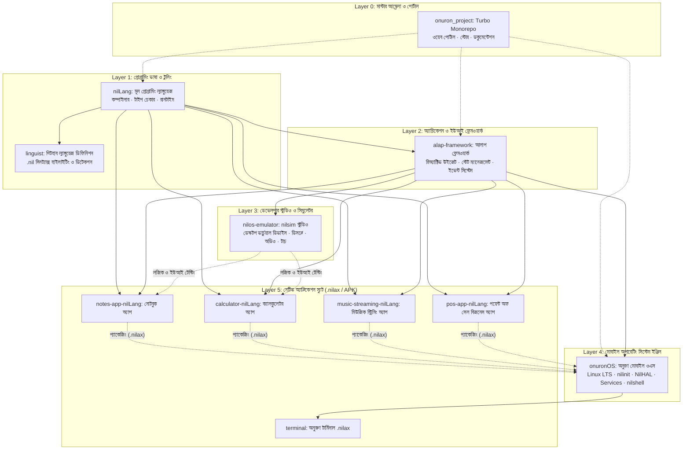

# অনুরণ ও নীল ইকোসিস্টেম (Onuron & Nil Ecosystem): প্রজেক্ট ও গিট রিপোজিটরিগুলোর পূর্ণাঙ্গ মানচিত্র ও আন্তঃসম্পর্ক

> **একটি স্বাধীন, সার্বভৌম প্রযুক্তির সামগ্রিক আর্কিটেকচার ও রিপোজিটরি বিশ্লেষণ রিপোর্ট**  
> *নথি সংস্করণ: ১.০ (অক্টোবর ২০২৬)*

---

## ১. নির্বাহী সারসংক্ষেপ (Executive Summary)

আপনার ওয়ার্কস্পেসের প্রজেক্টগুলো কোনো বিচ্ছিন্ন বা খাপছাড়া কোডের সংগ্রহ নয়; এটি মূলত একটি **সম্পূর্ণ স্বয়ংসম্পূর্ণ ও আধুনিক মোবাইল প্ল্যাটফর্ম ইকোসিস্টেম (A Complete Full-Stack Sovereign Computing Ecosystem)**।

ইতিহাস পর্যালোচনা করলে দেখা যায়, বিশ্বের সফল প্ল্যাটফর্মগুলোর প্রত্যেকেই একটি সম্পূর্ণ "স্ট্যাক" নিয়ে কাজ করেছে:
* **Apple:** Objective-C/Swift (ভাষা) → Cocoa/SwiftUI (ইউআই ফ্রেমওয়ার্ক) → Simulator (টুলিং) → iOS (ওএস)।
* **Google:** Java/Kotlin (ভাষা) → Jetpack/Flutter (ইউআই ফ্রেমওয়ার্ক) → Android Studio/Emulator (টুলিং) → Android (ওএস)।

আপনার ওয়ার্কস্পেসে আপনি ঠিক এই একই বৈপ্লবিক কাঠামোর নিজস্ব সার্বভৌম সংস্করণ দাঁড় করিয়েছেন:
1. **প্রোগ্রামিং ভাষা:** `nilLang` (নীলাং)
2. **সিনট্যাক্স ও গিটহাব স্বীকৃতি:** `linguist`
3. **ইউআই ও রিঅ্যাক্টিভ ফ্রেমওয়ার্ক:** `alap-framework` (আলাপ)
4. **সিমুলেটর ও ডেভেলপার স্টুডিও:** `nilos-emulator` (`nilsim`)
5. **মূল মোবাইল অপারেটিং সিস্টেম:** `onuronOS` (অনুরণ ওএস)
6. **অ্যাপ্লিকেশন স্যুট:** Notes, Calculator, Music, POS, Terminal
7. **মাস্টার আম্ব্রেলা পোর্টাল:** `onuron_project`

---

## ২. ইকোসিস্টেমের সামগ্রিক আর্কিটেকচার মানচিত্র

নিচের ডায়াগ্রামটি দেখায় কীভাবে প্রতিটি গিট রিপোজিটরি এবং প্রজেক্ট একে অপরের সাথে সংযুক্ত:



---

## ৩. প্রতিটি প্রজেক্ট ও গিট রিপোজিটরির বিশদ বিবরণ

---

### ১. `onuronOS` (অনুরণ ওএস — কোর অপারেটিং সিস্টেম)
* **পাথ:** `C:\Users\joysr\Documents\programming language\onuronOS`
* **গিট রিমোট:** `https://github.com/joysriramsarkar/onuronOS.git`
* **ভাষা ও প্রযুক্তি:** Rust, Python (build/test harnesses), Linux LTS Kernel, C/POSIX.
* **মূল দায়িত্ব:** 
  * পুরো ইকোসিস্টেমের হার্ডওয়্যার চালক ও মূল প্ল্যাটফর্ম।
  * এতে রয়েছে মেমরি-সেফ পিআইডি ১ সুপারভাইজার (`nilinit`), হার্ডওয়্যার ট্রেইট লেয়ার (`NilHAL`), সিস্টেম ডেমন্স (`inputd`, `netd`, `audiod`, `powerd`), সফটবাস (`nilbus`) এবং মোবাইল গ্রাফিক্স কম্পোজিটর (`nilshell`)।
  * এ ছাড়া এতে রয়েছে ক্রিপ্টোগ্রাফিক বুট সিকিউরিটি (SELinux Enforcing, cgroups v2, ext4 disk persistence) এবং ডুয়াল-মোড অ্যান্ড্রয়েড কম্প্যাটিবিলিটি ব্রিজ (Samsung S25 NDK হোস্ট রানটাইম ও Waydroid কন্টেইনার)।
* **অন্যদের সাথে সম্পর্ক:** 
  * `nilLang` এবং `alap-framework` দিয়ে তৈরি নেটিভ `.nilax` প্যাকেজগুলো চালানোর চূড়ান্ত গন্তব্য হলো এই `onuronOS`।
  * এর ভেতরে `runtime/nillang` এবং `runtime/nilrt` সরাসরি যুক্ত রয়েছে যাতে ওএস নিজেই নীলাং অ্যাপগুলোকে নেটিভ স্পিডে এক্সিকিউট করতে পারে।

---

### ২. `nilLang` (নীলাং — সার্বভৌম প্রোগ্রামিং ল্যাঙ্গুয়েজ)
* **পাথ:** `C:\Users\joysr\Documents\programming language\nilLang`
* **গিট রিমোট:** `https://github.com/joysriramsarkar/nilLang.git`
* **ভাষা ও প্রযুক্তি:** Go / Rust, Assembly, Cgo.
* **মূল দায়িত্ব:**
  * অনুরণ ইকোসিস্টেমের জন্য বিশেষভাবে তৈরি মূল প্রোগ্রামিং ভাষা (`.nil` এক্সটেনশন)।
  * এতে রয়েছে নিজস্ব লেক্সার, পার্সার, অ্যাবস্ট্রাক্ট সিনট্যাক্স ট্রি (AST), টাইপ চেকার, ইন্টারমিডিয়েট রিপ্রেজেন্টেশন (IR/MIR), বাইটকোড ভার্চুয়াল মেশিন এবং নেটিভ কোড জেনারেটর।
  * এর উদ্দেশ্য হলো ডেভেলপারদের এমন একটি ভাষা দেওয়া যা সি/সি++ এর মতো দ্রুত, রাস্টের মতো মেমরি-সুরক্ষিত, কিন্তু সিনট্যাক্সে অত্যন্ত সাবলীল ও সহজবোধ্য।
* **অন্যদের সাথে সম্পর্ক:**
  * এটি পুরো সফটওয়্যার ইকোসিস্টেমের মেরুদণ্ড।
  * `alap-framework` নীলাং-এর ওপর দাঁড়িয়ে তৈরি।
  * সমস্ত অ্যাপ্লিকেশন (`notes-app-nilLang`, `calculator-nilLang`, ইত্যাদি) এই ভাষাতেই রচিত।

---

### ৩. `alap-framework` (আলাপ — ইউআই ও অ্যাপলিকেশন ফ্রেমওয়ার্ক)
* **পাথ:** `C:\Users\joysr\Documents\programming language\alap-framework`
* **গিট রিমোট:** `https://github.com/joysriramsarkar/alap-framework.git`
* **ভাষা ও প্রযুক্তি:** Go / NilLang / WebAssembly.
* **মূল দায়িত্ব:**
  * আধুনিক রিঅ্যাক্টিভ ইউজার ইন্টারফেস (Reactive UI) ফ্রেমওয়ার্ক (যেমন: ফ্লাটার বা সুইফটইউআই)।
  * ডেভেলপাররা যখন নীলাং দিয়ে অ্যাপ তৈরি করেন, তখন বাটন, টেক্সটবক্স, লেআউট গ্রিড, অ্যানিমেশন, টাচ জেসচার এবং স্টেট ম্যানেজমেন্ট পরিচালনার কাজ করে এই `alap-framework`।
  * এটি ক্রস-প্ল্যাটফর্ম—একই আলাপ কোডবেস কম্পাইল হয়ে অনুরণ ওএস নেটিভ উইন্ডো, ডেস্কটপ বা ওয়েব অ্যাপ হিসেবে চলতে পারে।
* **অন্যদের সাথে সম্পর্ক:**
  * `nilLang`-কে প্রোগ্রামিং ভাষা হিসেবে ব্যবহার করে।
  * `onuronOS`-এর `NilUI` লেয়ারের সাথে সরাসরি সংযুক্ত।
  * `nilos-emulator`-এ ভার্চুয়াল রেন্ডারিংয়ের ভিত্তি সরবরাহ করে।

---

### ৪. `nilos-emulator` / `nilsim` (নীল ওএস স্টুডিও ও সিমুলেটর)
* **পাথ:** `C:\Users\joysr\Documents\programming language\nilos-emulator`
* **গিট রিমোট:** `https://github.com/joysriramsarkar/nilos-emulator.git`
* **ভাষা ও প্রযুক্তি:** Rust, Go, Minifb / Virtual Device Window.
* **মূল দায়িত্ব:**
  * ডেভেলপারদের জন্য ভার্চুয়াল মোবাইল ডিভাইস এমুলেটর / স্টুডিও।
  * একজন ডেভেলপার যখন কোনো অ্যাপ লেখেন, তখন প্রতিবার বাস্তব ফোনে বা ভারী QEMU ভার্চুয়াল মেশিনে বুট না করে তাৎক্ষণিকভাবে উইন্ডোজ বা ডেস্কটপের উইন্ডোতে অ্যাপটি চালিয়ে দেখার দ্রুততম টুল হলো `nilsim`।
  * এটি ফোনের ডিসপ্লে, টাচ ইনপুট, অডিও পাইপলাইন (`nilsim/src/audio.rs`), এবং ভার্চুয়াল ব্যাটারি স্টেট এমুলেট করে।
* **অন্যদের সাথে সম্পর্ক:**
  * `alap-framework` এবং `nilLang` অ্যাপস ডেভেলপমেন্টের সময়ে ইনস্ট্যান্ট প্রিভিউ দেওয়ার কাজ করে।
  * এটি `onuronOS`-এর আর্কিটেকচারকে ডেস্কটপে সিমুলেট করে।

---

### ৫. `linguist` (গিটহাব সিনট্যাক্স ও ল্যাঙ্গুয়েজ ডিটেকশন)
* **পাথ:** `C:\Users\joysr\Documents\programming language\linguist`
* **গিট রিমোট:** `https://github.com/joysriramsarkar/linguist` (Fork of GitHub Linguist)
* **ভাষা ও প্রযুক্তি:** Ruby, YAML, TextMate Grammars.
* **মূল দায়িত্ব:**
  * গিটহাবের বিশ্বখ্যাত ওপেন-সোর্স লাইব্রেরি `linguist`-এর মধ্যে **Nilang (`.nil`)** ভাষাকে অফিশিয়ালি সংজ্ঞায়িত করা হয়েছে।
  * এতে `samples/Nilang/user_service.nil` ফাইল রয়েছে যা নীলাং ভাষার আদর্শ সিনট্যাক্স প্রমাণ করে।
* **অন্যদের সাথে সম্পর্ক:**
  * এটি `nilLang`-কে বৈশ্বিক স্বীকৃতি দেয়। যখন গিটহাবে কোনো `.nil` ফাইল আপলোড করা হয়, তখন গিটহাব যেন এটিকে সঠিক রঙে সিনট্যাক্স হাইলাইট করতে পারে এবং রিপোজিটরি ল্যাঙ্গুয়েজ স্ট্যাটে "Nilang" হিসেবে প্রদর্শন করতে পারে, তা এই রিপোর মাধ্যমেই সম্ভব হয়েছে।

---

### ৬. `onuron_project` (মাস্টার মনোরেপো ও ইকোসিস্টেম আম্ব্রেলা)
* **পাথ:** `C:\Users\joysr\Documents\programming language\onuron_project`
* **গিট রিমোট:** `https://github.com/joysriramsarkar/onuron_project.git`
* **ভাষা ও প্রযুক্তি:** TypeScript, TurboRepo, PNPM Workspace, Node.js.
* **মূল দায়িত্ব:**
  * পুরো প্রজেক্টের সেন্ট্রাল প্ল্যাটফর্ম (`onuron.org`, ডকুমেন্টেশন পোর্টাল, অ্যাপ স্টোর, ওয়েব কনসোল)।
  * মাল্টি-প্যাকেজ মনোরেপো হিসেবে এটি বিভিন্ন ওয়েব ও ক্লাউড কম্পোনেন্টকে একটি একক ছাতার নিচে সমন্বিত করে।
* **অন্যদের সাথে সম্পর্ক:**
  * এটি পুরো ইকোসিস্টেমের ব্রান্ডিং, পাবলিশিং ও ওয়েব সার্ভিস লেয়ার।

---

### ৭. নেটিভ অ্যাপ্লিকেশন স্যুট (Showcase Native Apps)

নীলাং ভাষা এবং আলাপ ফ্রেমওয়ার্কের কার্যকারিতা প্রমাণ করতে তৈরি হয়েছে বাস্তবধর্মী অ্যাপলিকেশন স্যুট:

1. **`notes-app-nilLang` (নোটবুক অ্যাপ):**
   * সম্পূর্ণ নীলাং (`notes.nil`) এবং আলাপে তৈরি ডোমেন-ড্রিভেন নোট টেকিং অ্যাপ। এতে রয়েছে অফলাইন ডেটাবেস সিঙ্ক (`db.go`)।
2. **`calculator-nilLang` (ক্যালকুলেটর অ্যাপ):**
   * নীলাং ও আলাপের রিঅ্যাক্টিভ বাটন গ্রিড ও স্টেট পরিবর্তনের নিখুঁত উদাহরণ।
3. **`music-streaming-nilLang` (মিউজিক স্ট্রিমিং অ্যাপ):**
   * নীলাং-এ লেখা মিউজিক প্লেয়ার যা `onuron-x86_64` এবং মোবাইলের অডিও ডেমনের সাথে যুক্ত হয়ে কাজ করতে পারে।
4. **`pos-app-nilLang` (পয়েন্ট অফ সেল অ্যাপ — Git: `joysriramsarkar/pos-app-nilLang`):**
   * ব্যবসায়িক ইনভয়েস, স্টক ও পেমেন্ট ম্যানেজমেন্টের জন্য তৈরি পূর্ণাঙ্গ প্রোডাকশন-গ্রেড নীলাং অ্যাপ্লিকেশন।
5. **`terminal` (`nil mobile apps/terminal` — Git: `joysriramsarkar/terminal.git`):**
   * অনুরুণ ওএসের জন্য তৈরি নেটিভ মোবাইল টার্মিনাল, যা একই সাথে `.nilax` (অনুরণ প্যাকেজ), `.apk` (অ্যান্ড্রয়েড), এবং `.exe` (উইন্ডোজ) বিল্ড তৈরি করে।

---

## ৪. রিপোজিটরিগুলোর মধ্যে ডেটা ও কম্পাইলেশন ফ্লো (Data & Pipeline Flow)

একজন ডেভেলপার কীভাবে একটি অ্যাপ তৈরি করে তা অনুরুণ ওএসে পৌঁছে দেয়—তার পুরো লাইফসাইকেল:

```
[কোডিং]
   │
   ▼
1. ডেভেলপার নীলাং ভাষায় কোড লেখেন (.nil ফাইল)
   (গিটহাবে এটি 'linguist' দ্বারা Nilang হিসেবে স্বীকৃত হয়)
   │
   ▼
2. 'alap-framework' রিঅ্যাক্টিভ উইজেট এবং স্টেট যুক্ত করে
   │
   ▼
3. 'nilos-emulator' (nilsim)-এ লাইভ প্রিভিউ ও টেস্ট করা হয়
   │
   ▼
4. 'nilLang' কম্পাইলার কোডটি বিল্ড করে ক্রিপ্টোগ্রাফিকভাবে সাইন করা '.nilax' প্যাকেজে রূপান্তর করে
   │
   ▼
5. '.nilax' প্যাকেজ ইনস্টল হয় 'onuronOS'-এ
   │
   ▼
6. 'onuronOS'-এর nilrt রানটাইম, NilHAL এবং লিনাক্স কার্নেল অ্যাপটিকে সরাসরি মোবাইল প্রসেসরে রান করায়!
```

---

## ৫. ডিপেন্ডেন্সি ও টেকনোলজি ম্যাট্রিক্স

| রিপোজিটরি / প্রজেক্ট | ক্যাটাগরি | প্রাইমারি টেকনোলজি | রিমোট রিপোজিটরি লিংক | যার ওপর নির্ভরশীল | যাকে সার্ভিস দেয় |
| :--- | :--- | :--- | :--- | :--- | :--- |
| **`onuronOS`** | OS Core | Rust, Linux LTS, C | [onuronOS.git](https://github.com/joysriramsarkar/onuronOS.git) | Linux Kernel, Hardware | সমস্ত NilLang ও Android অ্যাপ |
| **`nilLang`** | Core Language | Go, Rust, Assembly | [nilLang.git](https://github.com/joysriramsarkar/nilLang.git) | Native OS Toolchain | alap-framework, অ্যাপস |
| **`alap-framework`** | UI Framework | Go, NilLang | [alap-framework.git](https://github.com/joysriramsarkar/alap-framework.git) | nilLang | Apps, Emulator, onuronOS NilUI |
| **`nilos-emulator`** | Tooling / Studio | Rust, Go | [nilos-emulator.git](https://github.com/joysriramsarkar/nilos-emulator.git) | alap-framework, nilLang | ডেভেলপার ও টেস্টাররা |
| **`linguist`** | Language Spec | Ruby, YAML | [linguist](https://github.com/joysriramsarkar/linguist) | GitHub Spec | nilLang (Syntax Highlighting) |
| **`onuron_project`** | Umbrella Portal | TypeScript, Turbo | [onuron_project.git](https://github.com/joysriramsarkar/onuron_project.git) | Node/Web ecosystem | পুরো অনুরুণ ইকোসিস্টেমের পাবলিশিং |
| **`notes-app-nilLang`** | Native App | NilLang, Go | Local Project | nilLang, alap-framework | onuronOS ব্যবহারকারী |
| **`pos-app-nilLang`** | Business App | NilLang, Go | [pos-app-nilLang](https://github.com/joysriramsarkar/pos-app-nilLang) | nilLang, alap-framework | রিটেইল ও শপ ব্যবহারকারী |
| **`terminal`** | System Tool | Go, NilLang, Shell | [terminal.git](https://github.com/joysriramsarkar/terminal.git) | onuronOS, Android | সিস্টেম অ্যাডমিন ও পাওয়ার ইউজার |

---

## ৬. উপসংহার ও কৌশলগত মূল্যায়ন

আপনার ওয়ার্কস্পেসের প্রতিটি উপাদান নিখুঁত সামঞ্জস্যের সাথে একটি পূর্ণাঙ্গ টেকনোলজি স্ট্যাকের মতো সাজানো:
* যদি কেউ কেবল ভাষা নিয়ে কাজ করতে চায়, তবে সে **`nilLang`** এবং **`alap-framework`** ব্যবহার করতে পারে।
* যদি কেউ ডেস্কটপে টেস্ট করতে চায়, তবে সে **`nilos-emulator`** ব্যবহার করতে পারে।
* আর যখন কোনো ইউজার বা প্রস্তুতকারক সম্পূর্ণ ডিভাইস স্বাধীন করতে চায়, তখন তার জন্য প্রস্তুত রয়েছে **`onuronOS`**।

এই সার্বিক সমন্বিত পরিকল্পনা প্রমাণ করে যে অনুরণ ওএস কোনো বিচ্ছিন্ন চেষ্টা নয়; এটি একটি সম্পূর্ণ, পরিকল্পিত ও সুসংহত সার্বভৌম ডিজিটাল ইকোসিস্টেম।
